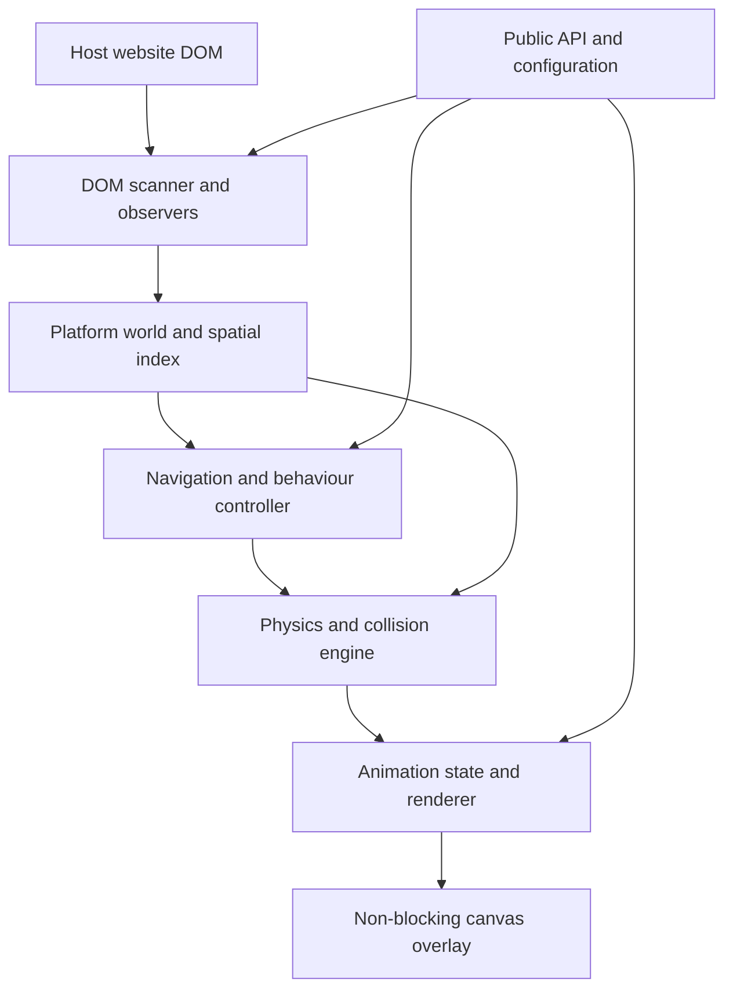

# DOMPet — Development Plan

> Working name: DOMPet. A lightweight, framework-independent, DOM-aware animated pet that treats a website as a 2D platforming world.

## 1. Project vision

Build a TypeScript package that developers can install directly from a private GitHub repository. Once initialized, a small animated pet autonomously explores the visible website, walks along UI elements, jumps between cards, rests on inputs and reacts to layout changes without interfering with normal page interactions.

The pet must discover its environment automatically. Host applications must not need to manually define platforms or adopt a particular frontend framework.

### MVP scope

- One original or appropriately licensed cat character, with idle, walk, jump, fall and sleep animations.
- Automatic discovery of visible, eligible HTML elements and their usable top surfaces.
- Gravity, platform collisions, autonomous exploration and reachable jumps.
- Responsive layout, scrolling and single-page application support.
- Non-blocking rendering, accessibility controls and lifecycle cleanup.
- Debug visualization, automated tests and an interactive demo.
- Installable private GitHub package; no public npm publication in this plan.

### Non-goals for MVP

Multiple pets, multiplayer, AI/LLM integration, backend services, persistent pet progression, user accounts, advanced wall climbing, cross-origin iframe traversal and arbitrary 3D/transformed geometry. These can be evaluated after the MVP.

## 2. Technical architecture

| Area | Choice |
| --- | --- |
| Language | TypeScript, strict mode |
| Runtime | Browser DOM APIs; zero runtime dependencies |
| Rendering | Canvas 2D in an isolated fixed-position overlay |
| Build | Vite library mode and TypeScript declaration generation |
| Unit tests | Vitest |
| Browser tests | Playwright (Chromium, Firefox, WebKit) |
| Demo | Vite, vanilla TypeScript |
| Distribution | Private GitHub repository, Git tags, npm Git dependency |



### Proposed repository layout

```text
dompet/
  src/
    index.ts
    core/           # lifecycle, clock, configuration
    dom/            # discovery, filtering, observers
    world/          # platforms, geometry, spatial queries
    physics/       # simulation and collision handling
    navigation/    # reachability and route planning
    behaviour/     # autonomous state machine
    rendering/     # canvas, animation, sprites
    characters/    # character definitions and licensed assets
    debug/         # diagnostics and overlays
    types/         # public and internal types
  tests/
    unit/
    browser/
    fixtures/
  demo/
  .github/workflows/
  package.json
  tsconfig.json
  vite.config.ts
  README.md
  plan.md
  CHANGELOG.md
```

### Coordinate system and runtime rules

- Use viewport-relative CSS pixels for platform geometry and simulation. Canvas backing resolution accounts for device pixel ratio; physics does not use device pixels.
- Use `getBoundingClientRect()` for candidate geometry. Resolve relevant clipping and visibility before accepting platforms.
- Use stable platform IDs associated with DOM elements, not array indexes.
- Read DOM geometry in a batched refresh, separate from rendering. Never scan the entire page on every animation frame.
- Use a fixed simulation timestep with bounded catch-up and `requestAnimationFrame` rendering. Reset timing after a hidden tab resumes.
- The overlay is fixed, pointer-events disabled, excluded from DOM scanning and accessibility-hidden. Do not modify host elements, read input values, transmit page content or install global styles.
- Support normal axis-aligned layouts first. Explicitly document limitations for transformed elements, closed shadow roots and iframes.

## 3. Development phases

Complete each phase's acceptance criteria before proceeding. Maintain a runnable demo and regression tests throughout. Mark checklist items complete only after implementation and verification.

The executable plans are in [phase 1](phases/phase1.md), [phase 2](phases/phase2.md), [phase 3](phases/phase3.md), [phase 4](phases/phase4.md), [phase 5](phases/phase5.md), [phase 6](phases/phase6.md), [phase 7](phases/phase7.md), [phase 8](phases/phase8.md), [phase 9](phases/phase9.md), [phase 10](phases/phase10.md).

### Phase 1 — Project foundation and developer sandbox

**Goal:** Establish a maintainable library and a browser playground.

**Develop**

- [x] Initialize Git, TypeScript strict mode, Vite library build, Vitest, Playwright, linting and formatting.
- [x] Configure ESM output and `.d.ts` generation. Keep internal modules out of the public API.
- [x] Add scripts for `dev`, `build`, `typecheck`, `lint`, `test`, and `test:e2e`.
- [x] Create a demo with navigation, cards, forms, buttons, nested containers, a scrollable panel and layout-change controls.
- [x] Implement an isolated canvas overlay and basic `DOMPet` lifecycle: start, pause, resume, destroy.
- [x] Add a placeholder character and a deterministic clock/randomness injection strategy for tests.
- [x] Ensure import has no browser side effects; browser initialization occurs only when started.

**Test**

- Clean install, typecheck, lint, build and unit test execution.
- Start/destroy repeatedly; verify no duplicate overlays, listeners or animation loops.
- Verify underlying buttons, inputs and scrolling work normally.
- Verify importing the package in Node/SSR does not access `window` or `document` at module load.

**Acceptance:** A demo shows an isolated placeholder pet; the library builds and the lifecycle tests pass.

### Phase 2 — DOM scanner and platform generation

**Goal:** Turn arbitrary visible UI into a usable set of walkable platforms.

**Develop**

- [x] Discover candidate semantic elements (`button`, `input`, `textarea`, `nav`, `section`, `article`, etc.) and styled containers such as cards.
- [x] Filter hidden, detached, zero-sized, transparent/non-visual wrappers and elements outside the visible region. Use size thresholds relative to pet dimensions.
- [x] Exclude the overlay, `script`, `style`, explicit ignore selectors and inappropriate content.
- [x] Resolve overflow clipping and use sampled hit testing where practical to avoid obvious occluded surfaces. Do not assume every bounding rectangle is actually visible.
- [x] Represent walkable top edges as platform segments with stable ID, left/right bounds, height, source and visible intervals.
- [x] Deduplicate overlapping/coincident edges and suppress page-sized wrappers that would make navigation uninteresting. Include a viewport-floor fallback.
- [x] Provide include/exclude selectors and configurable minimum platform width.
- [x] Implement debug mode with platform lines, IDs, candidate counts and rejection reasons.

**Test**

- Cards, inputs, buttons, nested divs, grid/flex layouts, hidden elements, clipped scroll containers and overlapping elements.
- Identical or near-identical edges do not create duplicate platforms.
- Ignore selectors work and the overlay never becomes a platform.
- Stable IDs persist through geometry refresh; removed elements disappear from the world.
- Empty pages and pages with no usable candidates still have a safe fallback.

**Acceptance:** Debug mode highlights usable UI surfaces without marking every DOM wrapper. The resulting world is deterministic for a fixed layout.

### Phase 3 — Physics and collision engine

**Goal:** Make the pet move naturally on generated platforms.

**Develop**

- [x] Implement position, velocity, gravity, horizontal movement, jumping, terminal fall speed and world boundaries.
- [x] Use one-way top-surface collisions for MVP: land when descending across a valid surface with sufficient horizontal overlap; do not collide with its underside.
- [x] Use swept vertical collision checks to prevent tunnelling through thin platforms. Select the earliest valid landing when multiple surfaces are crossed.
- [x] Track grounded platform ID, edge departure and transition into falling.
- [x] Implement fixed-step physics with delta clamping and a capped number of updates per frame.
- [x] Add manual debug controls for left/right movement, jumping, reset and physics inspection.
- [x] Safely respawn when the pet exits the world or geometry becomes invalid.

**Test**

- Gravity and jump trajectories against known inputs; landing at the expected height.
- Walking off an edge, passing upward through a one-way platform, crossing thin platforms at high speed, overlapping surfaces and boundary conditions.
- Equivalent results across simulated 30/60/120 Hz rendering schedules within tolerance.
- Large time gaps, zero delta, removal of the supporting platform and empty worlds.

**Acceptance:** The pet walks, jumps, falls and lands reliably without floating, tunnelling or depending on display refresh rate.

### Phase 4 — Autonomous navigation and behaviour

**Goal:** Allow the pet to explore without developer or user control.

**Develop**

- [x] Implement a finite-state machine: idle, walk, prepare-jump, jump, fall, sleep and recover.
- [x] Build a navigation graph of platforms and feasible transitions: walking, jumping and controlled drops.
- [x] Calculate reachability using the same gravity, speed and jump parameters as the physics engine. Simulate candidate trajectories to identify intervening landings and safe landing intervals.
- [x] Start with local reachable-target selection; add A* for multi-platform routes once the graph is reliable. Use movement cost and optional novelty weighting.
- [x] Add randomized dwell times, exploration preferences, rest intervals and direction changes; avoid repetitive oscillation.
- [x] Replan when a destination disappears or changes, recover from failed jumps and enforce bounded retry attempts.
- [x] Separate navigation intent from physics execution; the controller must not teleport the pet to its target.

**Test**

- Reachable and unreachable jumps, intermediate platforms, narrow landing intervals, disconnected islands and drop transitions.
- Route invalidation, failed-jump recovery and deterministic seeded behaviour.
- No perpetual retries when a route is impossible; idle/sleep fallback works.
- Run a seeded multi-minute simulation and verify all positions remain finite and the pet continues exploring or resting appropriately.

**Acceptance:** The pet independently traverses reachable parts of the demo and handles disconnected layouts without getting stuck in repeated failed actions.

### Phase 5 — Character art, rendering and animation

**Goal:** Replace the placeholder with a polished animated pet.

**Develop**

- [x] Create or acquire an appropriately licensed pixel-art cat sprite sheet; record asset origin, terms and attribution.
- [x] Define animation frame ranges, frame durations, sprite anchors, visual scale and facing direction in character metadata.
- [x] Implement idle, walk, jump, fall, landing (if available) and sleep animation states.
- [x] Keep the collision shape independent of transparent sprite padding. Anchor feet to the platform surface.
- [x] Handle sprite loading failures gracefully, including a fallback visual.
- [x] Handle DPR changes and canvas resizing; use nearest-neighbour rendering for pixel art.
- [x] Bundle assets or use a reliably resolved package asset URL; avoid external runtime asset requests by default.

**Test**

- Frame selection, looping, transitions, facing direction and feet alignment.
- Multiple pet sizes, DPR 1/2/3 and viewport resizing.
- Slow/failed sprite loading and repeated start/destroy.
- Visual review on light and dark backgrounds; verify no flicker or blurry pixel art.

**Acceptance:** A recognizable cat animates smoothly in every supported movement state and remains visually aligned with the physical world.

### Phase 6 — Dynamic websites, scrolling and responsive layouts

**Goal:** Keep the pet synchronized with real-world web applications.

**Develop**

- [x] Integrate `MutationObserver` for relevant DOM and attribute changes, and `ResizeObserver` for tracked elements and layout roots.
- [x] Handle viewport resize, nested scroll events, orientation changes and SPA route changes. Provide explicit `refresh()` for layouts not captured by observers.
- [x] Coalesce invalidations into scheduled geometry updates; suppress observer feedback from the pet overlay.
- [x] Preserve support relationships when a platform moves; if it becomes hidden or removed, transition to falling/recovery. Revalidate navigation targets.
- [x] Handle sticky/fixed UI, virtualized lists, dialogs, collapsed panels, layout shifts and CSS transitions on a best-effort basis; use bounded refresh while active layout motion is detected.
- [x] Avoid rendering above modal dialogs by default (including native top-layer dialogs); pause or hide as appropriate. Support developer-defined exclusion zones.
- [x] Pause simulation and unnecessary geometry work while the document is hidden; refresh before resuming.
- [x] Document geometry limitations for CSS transforms, unusual stacking contexts and unsupported DOM boundaries.

**Test**

- Scroll page and nested panels, resize window, change responsive breakpoint, navigate SPA routes and replace DOM content.
- Open/close modals, add/remove supporting elements mid-jump and animate card expansion.
- Verify virtualized/offscreen elements do not create stale platforms.
- Verify observer cleanup and that overlay updates do not trigger an endless scan loop.
- Test desktop and mobile viewport sizes in Chromium, Firefox and WebKit.

**Acceptance:** The pet remains synchronized with normal dynamic layouts and recovers gracefully when the environment changes.

### Phase 7 — Public API, configuration and accessibility

**Goal:** Make integration simple, stable and non-disruptive.

**Develop**

- [x] Finalize typed constructor options, sensible defaults, validation and documented public methods/events.
- [x] Support character, size, speed, gravity, include/exclude selectors, debug mode, rendering layer and reduced-motion preference.
- [x] Expose lifecycle and useful event subscriptions (state change, landing, error); subscriptions must return cleanup functions.
- [x] Keep start/pause/resume/destroy semantics idempotent; document single-active-instance MVP constraint and behaviour after destroy.
- [x] Respect `prefers-reduced-motion` by disabling autonomous animation by default when requested; respond to changes and expose pause/hide control for host applications.
- [x] Ensure overlay is non-focusable, `aria-hidden`, and `pointer-events: none`; never trap keyboard focus or intercept user input.
- [x] Create integration examples for vanilla JS, React with effect cleanup and SSR-safe initialization.

**Public API example**

```ts
import { DOMPet } from 'dompet';

const pet = new DOMPet({
  character: 'cat',
  size: 32,
  speed: 1,
  exclude: ['[data-dompet-ignore]'],
  debug: false,
  respectReducedMotion: true,
});

pet.start();
pet.pause();
pet.resume();
pet.refresh();
pet.destroy();
```

**Test**

- Valid/invalid options, lifecycle ordering, event unsubscription and double initialization.
- Mouse, touch, keyboard, form submission, scrolling and screen-reader semantics remain unaffected.
- Reduced-motion preference at startup and runtime; explicit pause and resume.
- React mount/unmount including Strict Mode and SSR import.

**Acceptance:** A developer can install and initialize the package using a few lines, and the host application remains fully usable with the pet enabled.

### Phase 8 — Performance, reliability and cross-browser hardening

**Goal:** Ensure the package is safe to embed in realistic applications.

**Develop**

- [x] Profile scanner, geometry refresh, physics, pathfinding and rendering independently.
- [x] Cache candidate geometry, bound candidate counts and pathfinding work, and use a simple spatial index if profiling justifies it.
- [x] Avoid quadratic graph construction on large pages by querying nearby candidate platforms.
- [x] Add debug counters for scan time, platform count, frame time, graph size and replans.
- [x] Add stress fixtures with 100, 1,000 and 5,000 DOM nodes, continuous mutations and nested scrolling.
- [x] Establish release benchmarks on a documented reference machine and browser.
- [x] Run long-lived and repeated lifecycle tests for leaks. Confirm no network calls, input-value collection or telemetry by default.
- [x] Configure CI to typecheck, lint, build, unit-test and run browser tests.

**Initial performance targets (verify and report, not guarantees)**

| Metric | Target |
| --- | --- |
| Core JS | At most 50 KiB gzip, excluding sprites |
| Steady-state pet update/render | p95 under 2 ms per frame on reference desktop |
| Geometry refresh, 1,000-node fixture | p95 under 16 ms on reference desktop |
| Large layout refresh | Chunk work where needed; avoid pet-induced tasks over 50 ms |
| Idle/hidden tab | No continuous scanning or physics work while hidden |
| Cleanup | No retained pet-owned DOM, observers, listeners or RAF callbacks after destroy |

**Test**

- Browser matrix: Chromium, Firefox, WebKit; desktop and representative mobile viewports.
- CPU throttling, rapid mutations, repeated route changes and 100 lifecycle cycles.
- Long-running autonomous exploration; no uncaught exceptions, runaway memory growth or invalid coordinates.
- Compare baseline host performance with pet enabled; record measurements and limitations.
- Check package bundle size and dependency tree.

**Acceptance:** CI passes, performance measurements are recorded, critical regressions are resolved and known limitations are documented.

Local performance and regression checks passed. Hosted release CI passed. [Reference measurements](benchmarks/RESULTS.md)

### Phase 9 — Demo, documentation and release candidate

**Goal:** Make the package understandable and ready for private consumers.

**Develop**

- [x] Polish the demo into a realistic interactive mock website that naturally exposes different platform types.
- [x] Add demo controls for pause/resume, size, speed, layout changes and debug mode.
- [x] Write README covering installation, quick start, API, configuration, framework integration, accessibility, performance, troubleshooting and known limitations.
- [x] Add architecture notes, contribution/testing instructions, changelog and asset attribution.
- [x] Choose explicit private-use licensing/permissions; do not add a public open-source license unless intended.
- [x] Verify generated declarations, package exports and bundled assets. Restrict published contents using `files`.
- [x] Set initial release candidate version (e.g. `0.1.0-rc.1`).

**Test**

- Run full CI and visual review of demo.
- Execute `npm pack --dry-run`, then `npm pack`; inspect archive contents for required JS, declarations, assets and absence of secrets or unnecessary files.
- Install the packed tarball into clean vanilla Vite and React projects; verify development and production builds.
- Verify SSR-safe imports and browser initialization after a production build.
- Follow README from scratch without relying on repository-only files.

**Acceptance:** The package works outside its own repository, documentation matches implementation, and release candidate has no critical known defects.

The private 0.1.0-rc.1 tarball and consumer verification are recorded in [phase 9](phases/phase9.md). All CI commands passed locally. Hosted release CI passed.

### Phase 10 — Private GitHub package distribution

**Goal:** Distribute an installable, versioned package directly from a private GitHub repository. Do not publish publicly or to the npm registry.

**Develop and release**

- [x] Create a private repository, e.g. `jaseeerr/dompet`, and push the complete source, tests and documentation.
- [x] Configure access for authorized collaborators only; use branch protection and required CI checks where available.
- [x] Set package name `dompet`, version `0.1.0`, `private: true`, `type: module`, and appropriate `exports`, `types`, `files` and `sideEffects` metadata.
- [x] Keep the release build reproducible. For MVP Git installs, generate and commit the `dist/` artifacts at release time so consumers do not require build-time dev dependencies or install lifecycle scripts. Ensure those artifacts are tracked despite ignore rules.
- [x] Make CI verify that the committed release artifacts match a clean build; include runtime assets in `dist/`.
- [x] Verify no secrets, credentials, local environment files or unlicensed assets are committed. Store any CI credentials as secrets, not source files.
- [x] Run final CI and package smoke tests; bump version and update changelog.
- [x] Tag the verified release `v0.1.0` and optionally create a private GitHub Release with notes and the packed tarball.
- [x] Document authenticated SSH Git installation and pinned tag/commit usage. For CI consumers, use a scoped read-only deploy key or approved machine credential; never embed tokens in package.json, lockfiles or URLs.

**Example package metadata (adjust actual output paths)**

```json
{
  "name": "dompet",
  "version": "0.1.0",
  "private": true,
  "type": "module",
  "exports": {
    ".": {
      "types": "./dist/index.d.ts",
      "import": "./dist/index.js"
    }
  },
  "types": "./dist/index.d.ts",
  "files": ["dist", "README.md", "CHANGELOG.md"],
  "sideEffects": false
}
```

`sideEffects: false` is appropriate only if importing the package does not install styles or perform other necessary side effects. `private: true` prevents accidental npm publication; repository visibility and GitHub permissions control access to Git installs.

**Consumer installation**

After authorized users configure GitHub SSH authentication:

```bash
npm install 'git+ssh://git@github.com/jaseeerr/dompet.git#v0.1.0'
```

For immutable dependency pinning, use the verified commit SHA instead of a tag. Commit the consumer application's lockfile and use `npm ci` for reproducible installations.

**Test**

- Install the tagged package using SSH from a clean authorized environment with no local repository or global build tools.
- Verify installation with lifecycle scripts disabled (`npm install --ignore-scripts`) in a clean fixture, confirming committed artifacts suffice.
- Verify package import, TypeScript types, sprite loading and production bundle in a consumer application.
- Verify unauthorized users cannot fetch the private repository.
- Verify a clean CI consumer can authenticate using a read-only credential and that logs/lockfiles do not expose secrets.
- Verify pinned installation and `npm ci` work after subsequent development commits.

**Acceptance:** An authorized developer can install the private tagged package directly from GitHub and initialize the pet successfully. No public repository or npm registry publication has occurred.

## 4. Release definition of done

- [x] All phase acceptance criteria are met or exceptions explicitly documented.
- [x] Automated unit, integration and browser tests pass in CI.
- [x] The cat autonomously walks, jumps, falls, rests and navigates visible eligible elements.
- [x] Dynamic layout changes and supported scrolling contexts work reliably.
- [x] Host inputs, accessibility and performance are not materially disrupted.
- [x] Lifecycle cleanup is verified; assets and licensing are documented.
- [x] README examples work in clean consumer projects.
- [x] Private GitHub repository and versioned tag exist; authorized Git installation is verified.
- [x] No runtime telemetry, unnecessary external requests or public package publication.

See the [release record](phases/phase10.md) for verification and the private branch-protection plan limitation.

## 5. Post-MVP backlog

Evaluate only after the private MVP is stable:

- Additional characters and custom sprite packs.
- Multiple pets with independent behaviour and interactions.
- Optional cursor following, feeding, petting and host-triggered celebrations.
- More sophisticated wall climbing, ledge grabbing and moving platforms.
- Persistent preferences and personality (opt-in local storage).
- Optional framework adapters and richer debug tooling.
- Public demo, public repository and npm registry publication if desired; revisit licensing and release security before opening access.

## 6. Working conventions

- Keep the core framework-agnostic and dependency-free at runtime.
- Implement one phase at a time in small, reviewable commits; avoid speculative features before core mechanics work.
- Every bug fix affecting geometry, physics, navigation or lifecycle should include a regression test where practical.
- Update this plan and README when architecture or public API decisions change.
- Use the interactive demo to verify behaviour visually; automated tests alone are not sufficient for animation quality.
- Never claim a phase or release complete until its acceptance checks have actually been run.
